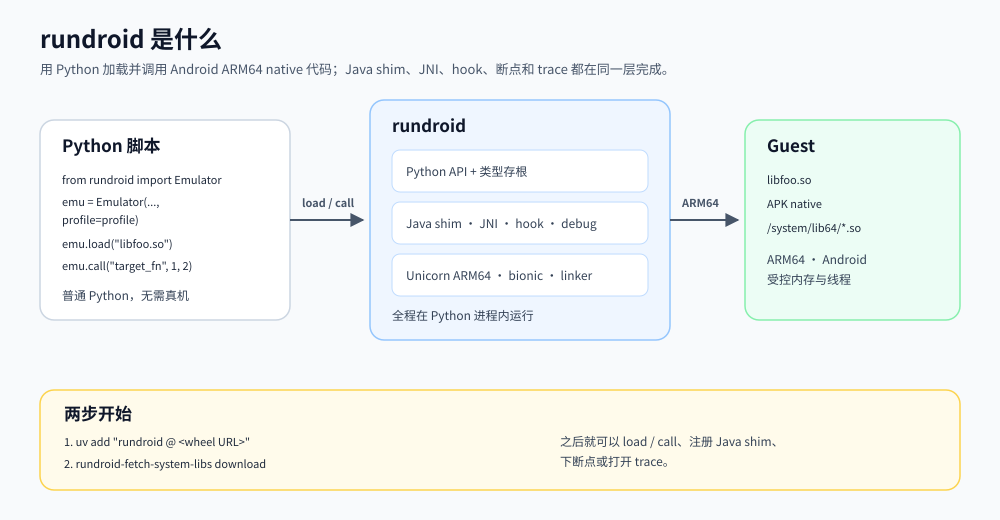
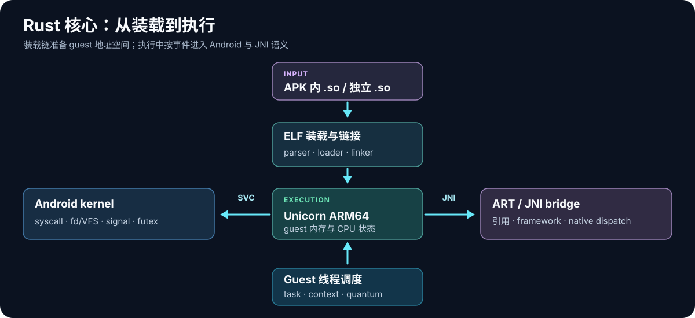

# rundroid

**用 Python 驱动 Android ARM64 native 代码，在同一个脚本里补环境、执行、观察和改写行为。**

rundroid 把 APK 或 `.so` 放进可控的 Android guest：Rust 负责 ARM64 执行、ELF 链接、Android syscall 与 JNI；Python 负责 Java shim、设备环境、拦截和调试。你可以围绕一个 native 入口反复运行分析脚本，不必为每次验证准备真机或完整 Android 系统。

适合复现 JNI 算法、分析依赖 Android 环境的 `.so`、定位 native 与 Java 交互，以及把一次性逆向步骤整理成可重复运行的 Python 脚本。

## 它怎样工作



你的脚本给出输入和环境，rundroid 在 guest 中完成 `load → JNI_OnLoad → native call`，再把返回值、事件和调试现场交还给 Python。Java 方法可以由 Python shim 提供；guest 调用的 libc、syscall 和内存访问也有对应的观察或拦截入口。

## 能做什么

| 能力 | 对分析工作的价值 |
| --- | --- |
| **装载真实 Android native 库** | 加载独立 `.so` 或 base APK 中的 ARM64 库，处理 ELF 依赖、重定位、constructor 和 guest `dlopen`；可选择执行 `JNI_OnLoad`。 |
| **从 Java 声明调用 native** | 通过 JNI descriptor 查找 `RegisterNatives` 或 `Java_*` 入口；`invoke_native` 自动处理 `JNIEnv*`、对象引用、参数编组和返回值。 |
| **用 Python 补 Java 行为** | 声明 Java class、方法和字段，为已有 framework 类扩展成员，或临时 hook、override、supplement 一个 Java 方法。无需运行 DEX 字节码。 |
| **给目标构造设备环境** | 配置系统属性、Settings、进程身份和文件系统；提供虚拟文件/设备、stdio 与 logcat，让目标读到脚本指定的值。 |
| **在执行现场观察和改写** | 断点、读写 watchpoint 与 syscall hook 可查看和修改现场；libc interposer 在真实函数入口回调 Python，可继续原函数或接管返回值。 |
| **控制 guest 线程** | 按需启用协作式线程调度，查询并冻结 guest 子线程，围绕多线程 native 路径定位问题。 |
| **留下可分析的证据** | 按范围或符号采集指令 trace，筛选 guest 事件；执行出错时查看 crashdump。固定 seed 便于复现依赖随机数的路径。 |

这些能力可以组合在一条脚本里：先补齐目标依赖的 Java/Android 环境，再装载库、命中断点、调整输入，最后检查 native 返回值和 trace。

## 最小调用链

下面的 `libfoo.so` 和 `target_fn` 是你自己的 ARM64 库与导出符号。运行时会在创建 session 时固定 `profile`，入口参数错误会直接报错，便于定位缺失的环境或不匹配的签名。

```python
from rundroid import AndroidEnvProfile, Emulator

profile = AndroidEnvProfile.from_mapping({
    "framework": {"system_properties": {
        "ro.build.version.sdk": "33",
        "ro.product.model": "rundroid",
    }},
    "syscall": {"cwd": "/data/local/tmp"},
})

emu = Emulator("arm64", "unicorn", 42, profile=profile)
module = emu.load("libfoo.so")

# 如果目标导出 JNI_OnLoad，先执行 emu.jni_onload(module)。
print(emu.call("target_fn", 1, 2))
```

针对 JNI native，可在装载并执行 `JNI_OnLoad` 后查询 Java 签名，再让 rundroid 完成 JNI 参数编组：

```python
emu.jni_onload(module)
native = emu.jni.find_native(
    java_class="com/example/Signer",
    java_method="sign([B)[B",
)
result = emu.invoke_native(native, b"payload")
```

第二段适用于实际导出 `JNI_OnLoad` 并注册了该方法的库。调用前还需注册目标用到的 Java class/native 声明；完整写法见 [Python 使用 Skill](skills/rundroid-python/SKILL.md)。

## Feature 展示

下面是一条独立于“最小调用链”的分析流程。各小节按顺序接续：先创建环境，再注册回调和装载目标，最后下断点、调用并采集 trace。示例中的 `libfoo.so`、`target_fn` 和 guest 路径要换成目标实际使用的值。

### 补设备画像与虚拟文件

`AndroidEnvProfile` 在创建 session 时固定设备信息；`emu.fs.map_file` 则把指定字节映射到 guest 路径，目标的 `open/read` 会读到这份内容。

```python
from rundroid import AndroidEnvProfile, CpuContext, Emulator, Interceptor, VirtFile

profile = AndroidEnvProfile.from_mapping({
    "framework": {
        "system_properties": {
            "ro.build.version.sdk": "33",
            "ro.product.model": "Pixel 7",
        },
        "settings": {"secure": {"android_id": "0123456789abcdef"}},
    },
    "syscall": {"cwd": "/data/local/tmp", "pid": 1234},
})
emu = Emulator("arm64", "unicorn", 42, profile=profile)
emu.fs.map_file(
    "/proc/self/status",
    VirtFile.bytes(b"Name:\ttarget\nPid:\t1234\n"),
)
```

虚拟文件还可以用 `VirtFile.host(...)` 显式映射宿主文件，或用动态 provider 生成内容；guest 路径与宿主路径是两套命名空间。

### 用 Python 补 Java 方法

Java shim 声明的是 guest 能找到的 class 和方法，方法行为由 Python 提供；注册要发生在目标使用该 class 之前。

```python
from rundroid.javashim import JavaClass, java_class, java_method

@java_class("com/example/DeviceInfo")
class DeviceInfo(JavaClass):
    @java_method("model()Ljava/lang/String;", static=True)
    def model() -> str:
        """向 guest 的 Java 调用返回设备型号。"""
        return "Pixel 7"

emu.art.register([DeviceInfo])
```

### Libc interposer：在真实入口观察调用

先注册、后装载。这里观察 `strlen` 的参数并返回 `False`，让真实 libc 函数继续执行；constructor 中首次调用也能命中。

```python
@Interceptor.libc("strlen")
def on_strlen(cpu: CpuContext) -> bool:
    """读取 guest 传给 strlen 的字符串。"""
    print("strlen input:", cpu.cdt.read_utf8("x0"))
    return False

emu.interceptor.register([on_strlen])
module = emu.load("libfoo.so")
```

若要替换返回值，在回调中调用 `cpu.cdt.set_retval(value)` 并返回 `True`。libc interposer 必须在首次 `load` 前注册。

### 断点：查看现场并改写参数

`breakpoint.add` 可以按导出符号或绝对地址下断点。回调里的 `CpuContext` 能读写 ARM64 寄存器，也能通过 `cpu.cdt` 查看内存、栈和 JNI 对象；它只在本次回调内有效。

```python
def on_target(cpu: CpuContext, address: int) -> bool:
    """命中 native 入口时读取现场，并改写第一个参数。"""
    print(f"hit {address:#x}, x0={cpu.regs.x0:#x}")
    cpu.regs.x0 = 42
    return True

handle = emu.breakpoint.add("target_fn", on_target)
print(emu.call("target_fn", 1, 2))
emu.breakpoint.remove(handle)
```

### Trace：只记录目标函数

trace scope 只覆盖 `with` 内的 guest 执行；按符号选范围，并把结果写到文件，避免全程指令输出淹没关键信息。

```python
with emu.trace_symbol(
    module,
    "target_fn",
    output="target.trace",
    whitelist_mods=["libfoo.so"],
):
    print(emu.call("target_fn", 1, 2))
emu.close()
```

### Guest 线程：查看与冻结子线程

线程调度需要在创建新 session 时启用。目标运行 `clone` 后，主调用返回到 host，才能查询或冻结仍存活的 guest 子线程；冻结只改变后续 guest 调度资格。

```python
thread_emu = Emulator("arm64", "unicorn", 42, profile=profile, thread_scheduler=True)
thread_emu.load("libthreaded.so")
thread_emu.call("start_worker")  # 示例：目标函数创建子线程后返回

for task in thread_emu.thread_scheduler_snapshot().threads:
    if task.is_main:
        continue
    print(task.tid, task.state, task.frozen)
    thread_emu.threads.freeze(task.tid)
    print(thread_emu.threads[task.tid])
    thread_emu.threads.unfreeze(task.tid)

thread_emu.close()
```

## Rust 核心怎样协同



- **ELF parser / loader / linker** 解析 ARM64 ELF、映射段、处理依赖与重定位，再按顺序执行 constructor；APK 内的 native 库走同一条装载链。
- **内存与 Unicorn** 持有 guest 地址空间和 CPU 状态。目标的真实 ARM64 指令在这里执行；断点、访存监听与指令 trace 接在执行现场。
- **Android kernel 与 ART/JNI** 分别接住 syscall 和 JNI 调用：文件、fd、线程、信号等由 kernel 模拟，Java 引用、framework stub 与 native 参数由 ART/JNI 桥处理。
- **Guest 线程调度器** 在一个宿主线程上保存、切换 guest task 的 CPU 上下文，协调 `clone`、`futex` 与等待。创建 `Emulator(..., thread_scheduler=True)` 后，可在两次 guest 调用之间通过 `emu.thread_scheduler_snapshot()` 查看线程，用 `emu.threads.freeze(tid)` / `unfreeze(tid)` 控制子线程的调度资格。

这套分层让 Python 专注于目标特有的补环境与观察逻辑，Rust 负责执行与 Android 语义。当前是单 guest 进程模型，guest 线程不会变成宿主后台线程。

## 安装

当前提供 **Linux x86_64 · CPython 3.13 · glibc ≥ 2.34** 的 wheel：

```bash
uv add "rundroid @ https://github.com/Lerr1uqs/rundroid-release/releases/download/v0.5.1/rundroid-0.5.1-cp313-cp313-manylinux_2_34_x86_64.whl"
rundroid-fetch-system-libs download
```

第二条命令准备锁定版本的 Android 13 / API 33 ARM64 guest runtime。wheel 包含 Rust 扩展、Python API、类型存根与资源工具；guest 系统库按需下载。安装条件、缓存位置和升级方法见 [安装指南](docs/install.md)。

| Host 平台 | 发行状态 |
| --- | --- |
| Linux x86_64 · CPython 3.13 | 已有 v0.5.1 wheel |
| Linux aarch64、macOS、Windows | 尚无对应 wheel |

当前 guest 固定为 **Android ARM64 / API 33**。APK 提供 native 库、manifest、签名证书和 assets；rundroid 不执行 DEX 字节码，也不是完整 Android 系统。单一 base APK 可在构造 `Emulator(..., apk="base.apk")` 时绑定。

## 安装 rundroid-python Skill

`rundroid-python` 是给支持 Skills 的编码工具使用的脚本编写指南，涵盖资源准备、Java shim、JNI、断点、trace 与补环境。它与 rundroid wheel 是两项独立安装内容。

已安装 Node.js/npm 时，在你编写 rundroid 脚本的项目目录运行：

```bash
npx skills add https://github.com/Lerr1uqs/rundroid-release/tree/main/skills/rundroid-python
npx skills list
```

安装命令会检测编码工具，并在需要时提示选择目标；默认安装在当前项目。要在所有项目中使用，给 `add` 加 `-g`，并用 `npx skills ls -g` 查看。安装后可在支持显式调用的工具中说“使用 `$rundroid-python` 帮我编写一个带 JNI 断点的分析脚本”。安装方式详见 [Skills CLI 文档](https://github.com/vercel-labs/skills/blob/main/docs/commands.md)，具体能力见本仓库的 [Skill 说明](skills/rundroid-python/SKILL.md)。

## 深入使用

- [安装与升级](docs/install.md) · [wheel 内容](docs/artifacts.md) · [guest runtime 资源](docs/runtime-assets.md)。
- [源码仓库](https://github.com/Lerr1uqs/rundroid) · [反馈问题](https://github.com/Lerr1uqs/rundroid-release/issues)。

## 许可证

MIT，见 [LICENSE](LICENSE)。
