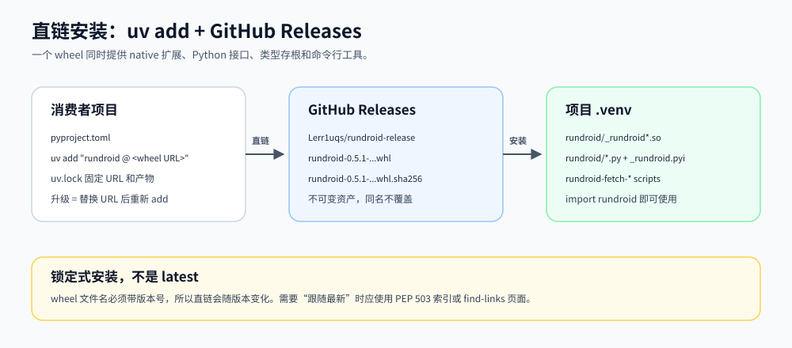
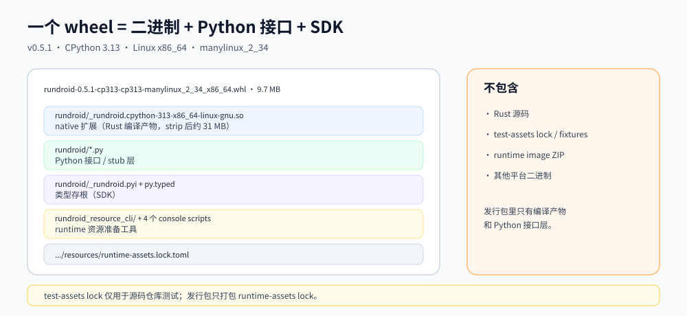
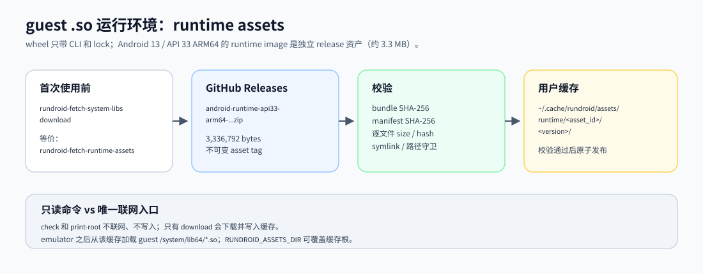
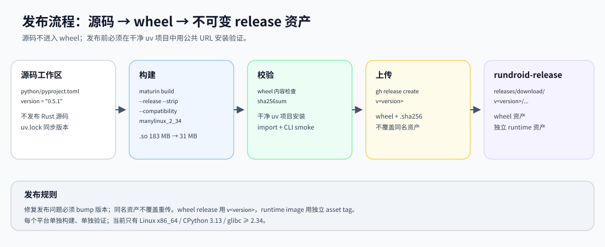

# rundroid release

rundroid 的**二进制发行仓库**。这里只发布可安装产物、校验信息和使用文档，**不包含 Rust 源码**。

- 主仓库只负责源码与构建；本仓库只负责不可变的发布资产。
- Python 安装产物是一个 wheel：编译后的 native 扩展 + Python 接口层 + 类型存根。
- guest `.so` 运行环境（API 33 ARM64 runtime image）是独立资产，由 wheel 内的 CLI 下载。
- 当前发行范围：**Unix**。已发布平台见下表。

## 快速安装

Linux x86_64 + CPython 3.13：

```bash
uv add "rundroid @ https://github.com/Lerr1uqs/rundroid-release/releases/download/v0.5.1/rundroid-0.5.1-cp313-cp313-manylinux_2_34_x86_64.whl"
```

`uv add` 会写入使用方的 `pyproject.toml`：

```toml
[tool.uv.sources]
rundroid = { url = "https://github.com/Lerr1uqs/rundroid-release/releases/download/v0.5.1/rundroid-0.5.1-cp313-cp313-manylinux_2_34_x86_64.whl" }
```

> 这是**锁定式安装**：URL 同时包含版本、Python ABI 和平台。升级时替换 URL 并重新
> `uv add`；`uv.lock` 固定实际产物，保证可复现。

## 当前发布

| Release | 平台 | Python | glibc | 产物 |
|---|---|---|---|---|
| [v0.5.1](https://github.com/Lerr1uqs/rundroid-release/releases/tag/v0.5.1) | Linux x86_64 | CPython 3.13 | >= 2.34 | wheel + `.sha256` |
| [v0.5.0](https://github.com/Lerr1uqs/rundroid-release/releases/tag/v0.5.0) | Linux x86_64 | CPython 3.13 | >= 2.34 | wheel + `.sha256` |
| [android-runtime-api33-arm64](https://github.com/Lerr1uqs/rundroid-release/releases/tag/android-runtime-api33-arm64-TQ1A.230205.001.D2-9471403) | guest ARM64 | — | — | runtime image ZIP |

> **v0.5.0 的 resource CLI 不包含 runtime lock**，`rundroid-fetch-system-libs` 无法在干净环境
> 工作。请使用 v0.5.1。

## 产物组成

### wheel（Python SDK + 二进制）

```text
rundroid/
  _rundroid.cpython-313-x86_64-linux-gnu.so   # native 扩展，已 strip
  *.py                                        # Python 接口层（stub 层）
  _rundroid.pyi                               # 类型存根
  py.typed
rundroid_resource_cli/
  resources/runtime-assets.lock.toml          # runtime 资源锁
```

wheel 同时安装这些 console scripts：

- `rundroid-fetch-system-libs`
- `rundroid-fetch-runtime-assets`
- `rundroid-extract-runtime-assets`

`rundroid-fetch-test-assets` 仅供源码仓库测试使用，发行包不包含 test fixture。

### guest `.so` 运行环境

runtime image 是独立资产（约 3.3 MB），首次使用前显式准备：

```bash
rundroid-fetch-system-libs download
# 与 rundroid-fetch-runtime-assets download 等价
```

默认缓存：

```text
Linux/macOS: $XDG_CACHE_HOME/rundroid/assets
未设置 XDG_CACHE_HOME: ~/.cache/rundroid/assets
```

`check` 与 `print-root` 不联网、不写入；只有 `download` 会联网并写入缓存。

## 平台支持

| Host | 状态 |
|---|---|
| Linux x86_64，CPython 3.13，glibc >= 2.34 | ✅ v0.5.1 |
| Linux aarch64 | 未构建 |
| macOS arm64 / x86_64 | 未构建 |
| Windows | 当前不发布 |

## 文档

- [安装与升级](docs/install.md)
- [wheel 内容与边界](docs/artifacts.md)
- [guest runtime assets](docs/runtime-assets.md)
- [发布流程](docs/release-process.md)
- [仓库结构与同步策略](docs/repository-layout.md)

## 图









## Skill

面向使用者的 `rundroid-python` skill 已公开在本仓库：

```bash
npx skills add https://github.com/Lerr1uqs/rundroid-release/tree/main/skills/rundroid-python
```

skill 只讲 Python 使用方式、JNI stub、breakpoint、trace 和资源准备，不包含源码。

## 校验

每个 wheel 都附带同名 `.sha256` 文件：

```bash
curl -LO "https://github.com/Lerr1uqs/rundroid-release/releases/download/v0.5.1/rundroid-0.5.1-cp313-cp313-manylinux_2_34_x86_64.whl"
curl -LO "https://github.com/Lerr1uqs/rundroid-release/releases/download/v0.5.1/rundroid-0.5.1-cp313-cp313-manylinux_2_34_x86_64.whl.sha256"
sha256sum -c rundroid-0.5.1-cp313-cp313-manylinux_2_34_x86_64.whl.sha256
```

v0.5.1 wheel SHA-256：

```text
049769029fbc80c6f0bc92b0f6403658c97bcd9ab56e43b4ef6752cfcf6183f8
```

## 许可证与第三方组件

- 本仓库文档与 wheel 中的 Python 接口层：MIT，见 [LICENSE](LICENSE)。
- wheel 内的 native 依赖清单见 dist-info 中的 CycloneDX SBOM。
- runtime image 内的第三方组件与许可证见 ZIP 中的 `NOTICE/`。
- 本仓库不包含 Rust 源码；源码不在发布范围内。
